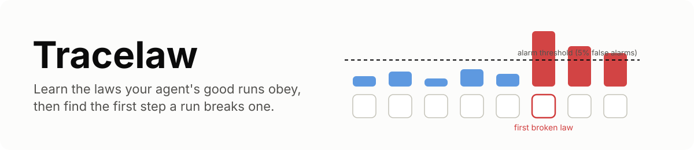
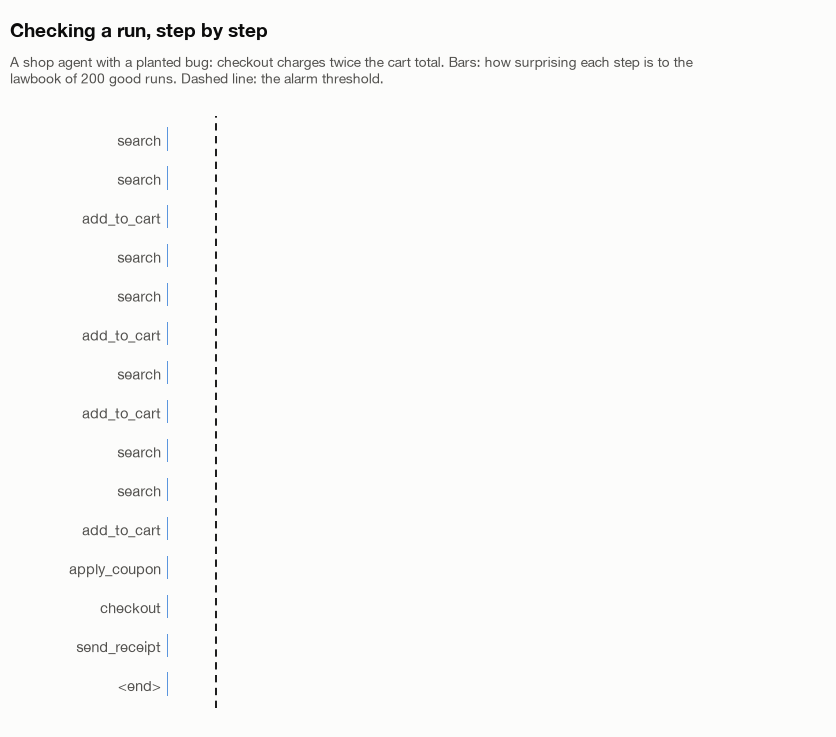
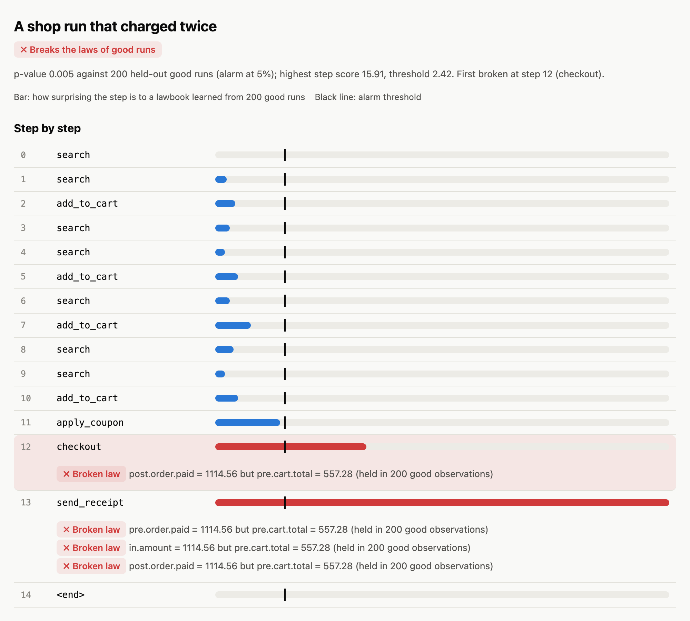
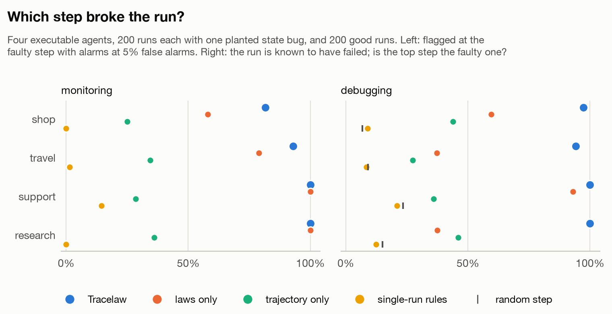
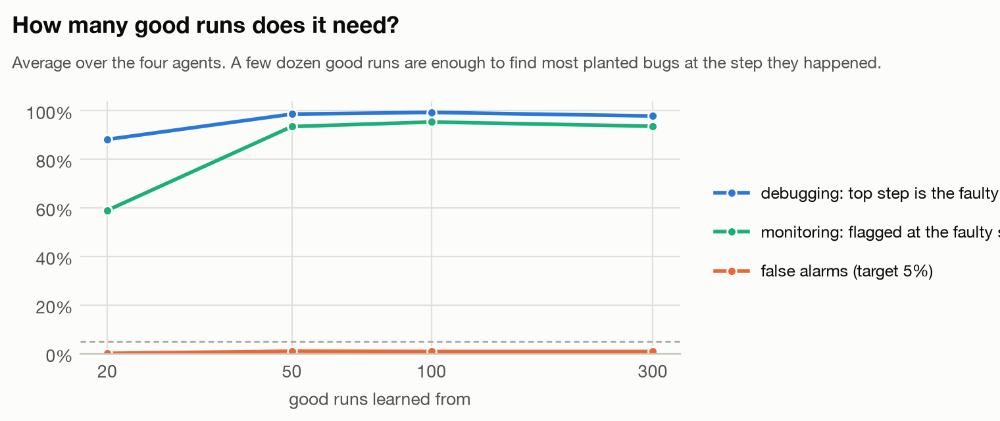
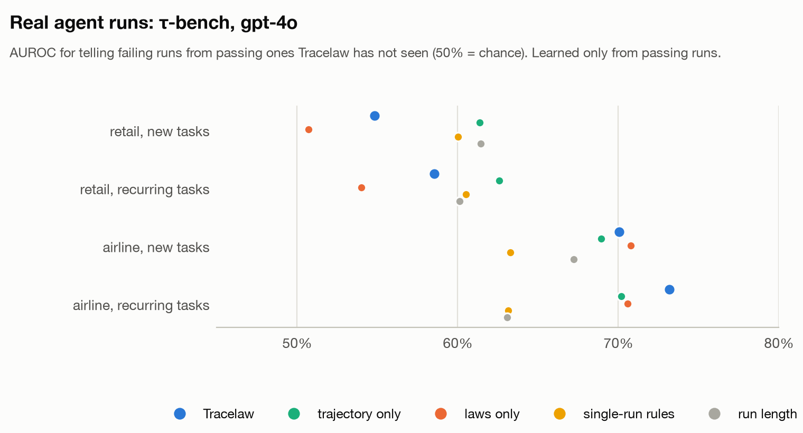

<picture>
  <source media="(prefers-color-scheme: dark)" srcset="docs/assets/banner-dark.svg">
  
</picture>

**Tracelaw learns the laws your agent's good runs obey (the total is the sum of the
items, the refund is the order's amount, the receipt goes to the user's address, the
agent only uses order ids it has looked up) and points at the first step where a new
run breaks one.**

Agents rarely fail loudly. They charge twice, book one seat too many, cite a note they
never wrote, or loop politely between two tools, and every step looks plausible on its
own. Tracing tools record all of it but judge each run alone, with fixed rules such as
"the same step three times in a row is a loop", which miss what is wrong for *your*
agent and flag what is normal for it.

Tracelaw judges a run against your agent's own good runs:

1. **Laws over state, arguments and outputs**, mined per step type: values that stay
   unchanged, counters that move by one, totals that are sums, balances that are
   `previous + amount`, arguments that equal a state field or an id seen earlier. Each
   law keeps its support, so a law seen 500 times outweighs one seen 5 times.
2. **A model of the step sequence** that catches loops, skipped steps and runs cut
   short, without flagging the repetition good runs also have.
3. **Calibrated alarms.** Choose the false-alarm rate; cross-conformal calibration on
   good runs sets the threshold, and every run gets a p-value.
4. **Evidence, not a score.** The first broken step, and every broken law with how often
   it held and what this run did instead.

<picture>
  <source media="(prefers-color-scheme: dark)" srcset="docs/assets/check-dark.gif">
  
</picture>

## Quickstart

```bash
pip install "tracelaw @ git+https://github.com/Sanika0212/Tracelaw"
```

```python
from tracelaw import Lawbook, Run, Step

# one Step per tool call or node, with whatever you have: state, inputs, outputs
run = Run("r1", [
    Step("lookup_order", inputs={"order_id": "o123"}, outputs={"amount": 42.0}),
    Step("refund", inputs={"order_id": "o123", "amount": 42.0},
         state_before={"balance": 10.0}, state_after={"balance": 52.0}),
])

book = Lawbook.learn(good_runs, alpha=0.05)    # good runs of your agent
verdict = book.check(new_run)
if verdict.flagged:
    print(f"broken at step {verdict.first_step} (p = {verdict.p_value:.3f})")
    for finding in verdict.culprit:
        print(finding.message)
```

On a refund agent that pays twice ([examples/quickstart.py](examples/quickstart.py)):

```text
learned: refund: refunds changes by exactly 1
learned: refund: post.balance equals pre.balance + in.amount

flagged: True (p = 0.010), first broken at step 1
   refunds changed by 2 (0 to 2), not 1 (held in 100 good observations)
   post.balance = 243.79 but pre.balance + in.amount = 159.25 (held in 100 good observations)
```

## From the command line

```bash
tracelaw learn good-runs.jsonl --out laws.json         # or --format taubench | otel | counterfact
tracelaw check new-runs.jsonl --laws laws.json --html report.html --fail
tracelaw explain laws.json --step checkout              # the laws, in words
```

```text
checkout: in.amount equals pre.cart.total  (held in 200 good observations)
checkout: post.order.paid equals pre.cart.total  (held in 200 good observations)
checkout: in.user_id equals pre.user.id  (held in 200 good observations)
checkout: adds is left unchanged  (held in 200 good observations)
```

The report is a single HTML file: the run step by step, each step's score against the
alarm threshold, the first broken step marked, and every broken law under its step.

<picture>
  <source media="(prefers-color-scheme: dark)" srcset="docs/assets/report-dark.png">
  
</picture>

## Where runs come from

1. **Your code**: build `Run` and `Step` objects, or write JSON Lines.
2. **Chat transcripts with tool calls** (OpenAI message format):
   `tracelaw.importers.from_messages`, which also tracks the ids the conversation has
   seen and whether the user just agreed to something; τ-bench files load directly.
3. **OpenTelemetry**: OTLP JSON spans that follow the GenAI semantic conventions.
4. **Counterfact** recordings, so the runs Counterfact already captured can be checked
   (Counterfact finds which step caused a failure by replaying it; Tracelaw needs no
   replay, only the traces).

## In tests

```python
from tracelaw.testing import assert_obeys

def test_refund_agent(lawbook):              # pytest --tracelaw-laws laws.json
    assert_obeys(record_run("refund order o123"), lawbook)
```

## Results

Every number comes from [docs/benchmarks.md](docs/benchmarks.md), with the commands to
reproduce it.

### Planted state bugs in four agents

Four executable agents (a shop, travel booking, a support desk with refunds, a research
loop), with the randomness real agents have. Each test run gets one planted bug (a
wrong update, a missed update, a duplicated tool effect, a wrong argument, an
`A B A B` loop or a skipped step) and carries on from the corrupted state. Lawbooks are
learned from 300 good runs.

<picture>
  <source media="(prefers-color-scheme: dark)" srcset="docs/assets/faults-dark.png">
  
</picture>

| Method | False alarms on good runs | Monitoring: flagged at the faulty step | Debugging: top step is the faulty one |
|---|---|---|---|
| **Tracelaw** | **0.9%** (target 5%) | **93.6%** | **97.8%** |
| Laws only | 0.0% | 84.3% | 56.8% |
| Trajectory only | 0.9% | 31.0% | 38.3% |
| Single-run rules (repeat, length, error) | 19.5% | 4.0% | 12.7% |
| Blame the last step | | | 12.3% |
| A random step | | | 13.6% |

Averages over the four agents. The laws find state bugs, the trajectory finds loops and
skipped steps; together they find both, and the per-step evidence is what points at
the right step. The fixed rules raise false alarms on 62% of good shop runs, which
legitimately search three times in a row. Shop loops are the hardest case (35% flagged
at the loop): a repeated search-and-add is normal behaviour until it repeats too often.

**How many good runs are needed?** With 20 good runs, Tracelaw already names the faulty
step in 88% of failing runs; from 50, in about 98%.

<picture>
  <source media="(prefers-color-scheme: dark)" srcset="docs/assets/curve-dark.png">
  
</picture>

### Real agent runs: τ-bench

τ-bench's published trajectories: gpt-4o as a customer-service agent with tools on a
retail database (460 runs) and an airline database (200 runs), each passing or failing
by the database's final state. Tracelaw learns only from passing runs and must rank the
failing runs it has not seen above the passing ones.

<picture>
  <source media="(prefers-color-scheme: dark)" srcset="docs/assets/taubench-dark.png">
  
</picture>

| Domain | Setting | AUROC | Laws only | Trajectory only | Run length | Flagged: failing / passing (alpha 10%) |
|---|---|---|---|---|---|---|
| airline | new tasks | **0.701** | 0.708 | 0.690 | 0.672 | 47.4% / 14.3% |
| airline | recurring tasks | **0.732** | 0.706 | 0.702 | 0.631 | 30.5% / 7.3% |
| retail | new tasks | 0.548 | 0.507 | 0.614 | 0.614 | 21.4% / 14.4% |
| retail | recurring tasks | 0.586 | 0.540 | 0.626 | 0.601 | 13.8% / 8.1% |

On airline runs Tracelaw is the best of the methods compared. On retail it is not: most
retail failures are a wrong choice among valid options (the wrong item variant, the
wrong payment method), which breaks no law, and even the run's length predicts failure
better. On tasks Tracelaw has never seen (new users, orders and requests), passing runs
also look less familiar and false alarms rise above the target (14% at 10%); when the
same kinds of requests recur, as in monitoring a deployed agent, they stay below it
(7% to 8%).

## How it works

[docs/how-it-works.md](docs/how-it-works.md) covers variables, the law kinds and the
rules that keep them honest, the trajectory model, scoring and cross-conformal
calibration.

## Limits

1. **It needs good runs**: a few dozen of the agent you monitor, as close as possible to
   the runs you will check.
2. **Laws see what you record.** State bugs are found only if state is captured. A wrong
   choice among valid options breaks no law (τ-bench retail).
3. **New kinds of tasks look unusual.** Relearn when the agent, its tools or its users
   change.
4. **Laws are exact.** A legitimate exception breaks its law until the lawbook is
   relearned on runs that include it.

## Development

```bash
uv sync --extra viz
uv run ruff check src tests scripts examples && uv run mypy
uv run coverage run -m pytest && uv run coverage report
```

See [CONTRIBUTING.md](CONTRIBUTING.md).

## References

1. Ernst, Perkins, Guo, McCamant, Pacheco, Tschantz and Xiao, *The Daikon system for
   dynamic detection of likely invariants*, Science of Computer Programming, 2007.
2. Vovk, *Cross-conformal predictors*, Annals of Mathematics and Artificial
   Intelligence, 2015.
3. Begleiter, El-Yaniv and Yona, *On Prediction Using Variable Order Markov Models*,
   JAIR 2004.
4. Yao, Shinn, Razavi and Narasimhan, *τ-bench: A Benchmark for Tool-Agent-User
   Interaction in Real-World Domains*, 2024.

## License

Apache License 2.0. Copyright 2026 Sanika Najan. See [LICENSE](LICENSE) and
[NOTICE](NOTICE).
